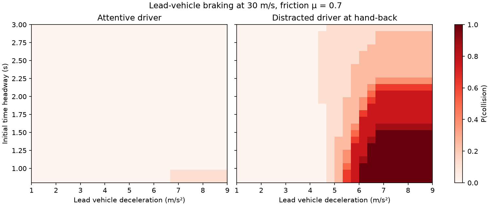

# Validation of a learned ADAS function with agent-driven failure discovery

A SOTIF-inspired verification and validation demonstrator for a learned SAE Level 2 Adaptive
Cruise Control that hands control back to the driver when it cannot cope. Exposure-weighted
simulation campaigns alone decide the validation status, against acceptance criteria with
explicit evidence rules. Failure discovery is a separate activity: an LLM agent (agentic
validation) searches for triggering conditions and is benchmarked against six non-LLM search
strategies under a frozen protocol, with its conditions re-tested on a fresh hold-out
campaign.

> **Data status.** Driver reaction times come from named published studies
> (`config/driver.yaml`). Exposure weights, acceptance thresholds, ODD ranges and several
> driver-response parameters are placeholders (`TODO(data)` in `config/`). Every number below
> is conditional on them and on this simulator and controller: the results show the method,
> not real-world risk.

**Reading guide**

1. This README: overview and findings.
2. [`docs/evaluation.md`](docs/evaluation.md), [`docs/limitations.md`](docs/limitations.md): method and limits.
3. [`results/benchmark.md`](results/benchmark.md), [`docs/agent.md`](docs/agent.md): the agent benchmark.
4. [`docs/corrections.md`](docs/corrections.md): what v0.2 got wrong and how it was found.
5. [`tests/`](tests/), [`avval/`](avval/): the implementation.
6. [`results/README.md`](results/README.md) (what each result file is),
   [`results/EVIDENCE_MANIFEST.json`](results/EVIDENCE_MANIFEST.json) and the
   [v1.0 release asset](https://github.com/janlucakaestle/adas-validation-agent/releases/tag/v1.0): verification.



*Lead-vehicle braking at 30 m/s, μ = 0.7. The attentive driver avoids contact almost
everywhere; a distracted driver handed control back collides more often as the lead brakes
harder and the headway shrinks. This is the pattern behind AC-03 below.*

## What the evidence showed

Final evidence of release `fe59625d…` ([`results/`](results/)). Corrections to the v0.2
findings are in [`docs/corrections.md`](docs/corrections.md).

1. **This project's own v0.2 finding of a hand-back monitor blind spot was wrong, and is
   retracted.** The acceleration-aware TTC behind it let a stopping lead vehicle carry on
   past standstill, as if it reversed into the ego vehicle. Simulator validity is part of
   the evidence. With corrected, stop-aware physics, none of 180,000 baseline runs erodes the
   margin without a hand-back ([`findings.md`](results/findings.md)), and the estimation has
   no hazardous run without a takeover request
   ([`handback_diagnostics_estimate.md`](results/handback_diagnostics_estimate.md)). The
   analytic stopping-lead tests and the timestep-convergence tests exist because of it.
2. **The agent was reliable, but not uniquely so.** It found the rare attentive-driver
   collision region in 10 of 10 seeds. That beats random, grid and boundary search and is
   borderline against evolutionary search (95% upper bound 0.043 against 0.05). It showed no
   advantage over CEM, and Bayesian optimisation matched it (100 of 100 campaigns). Every
   numerical method reached its first collision in fewer runs (17.4–23.5 against 42.5,
   restricted mean) ([`benchmark.md`](results/benchmark.md)). The agent can read the
   `avoidable_by_reference` label, which is part of the target region, while the numerical
   baselines' objective does not use it, so this compares complete strategies, not
   optimisation efficiency ([method](docs/agent.md#benchmark-methodology)); a
   target-agnostic ablation is on the [roadmap](docs/roadmap.md).

   | | agent | random | grid | cem | evolutionary | boundary | bayesopt |
   | --- | --- | --- | --- | --- | --- | --- | --- |
   | Campaigns | 10 | 100 | 100 | 100 | 100 | 100 | 100 |
   | Region detected | 1.00 | 0.61 | 0.58 | 0.81 | 0.75 | 0.18 | 1.00 |
   | Runs to first collision | 42.5 | 20.9 | 19.9 | 17.4 | 22.9 | 23.5 | 19.1 |

3. **Some agent conditions were ODD corners, not triggering conditions.** On 100,000 fresh
   hold-out runs, 8 of the 10 cut-in conditions have zero exposure measure: they bound
   headway or closing speed at the edge of the ODD (e.g. `headway <= 0.3`, a single point).
   The distracted-driver hard-braking condition did generalise: exposure-supported in 8 of
   10 seeds, with a collision rate of 22.2–69.8% inside
   ([`holdout_predicates.md`](results/holdout_predicates.md)). Agent-generated conditions
   therefore need held-out validation before they count as triggering conditions.
4. **A component meets its requirement while the fallback concept fails.** No takeover
   request is missed or late (AC-07: 0 of 2,647). Yet 47.7% of distracted-driver runs that
   need a hand-back end in a collision (AC-03, n = 537): the request arrives in time, but a
   distracted driver cannot use it ([`report_estimate.md`](results/report_estimate.md)).
5. **The hand-over trades sensitivity against specificity.** Indicative, from single
   2,000-run one-at-a-time variants (55 runs per variant need a hand-back, 1,945 do not).
   At the nominal required-deceleration threshold of 3.0 m/s², 0 of 55 hand-backs are
   missed or late and 381 of 1,945 (19.6%) are unneeded. Raising it to 3.5 m/s², the
   braking authority and hand-back oracle level, misses 4 of 55 (355 of 1,945 unneeded);
   lowering it to 2.5 m/s² raises unneeded hand-backs to 588 of 1,945 (30.2%), with 0 of 55
   missed. The TTC threshold works the same way: against the nominal 2 s, unneeded
   hand-backs fall to 305 of 1,945 (15.7%) at 1.5 s and rise to 1,065 of 1,945 (54.8%) at
   3 s, with 0 of 55 missed in both. Across all 171 variants, the 3.5 m/s² threshold fails
   AC-07 in 33 of 33, and 2.5 m/s² fails AC-08 in 33 of 33.
   AC-03 fails in all 171
   ([`sensitivity_oat.csv`](results/sensitivity_oat.csv), [OAT](results/sensitivity_oat.md),
   [factorial](results/sensitivity_factorial2.md), [LHS](results/sensitivity_lhs.md)).

## Acceptance criteria

100,000 exposure-weighted runs. Validation status: **NO-GO**. The formal release decision
is also **NO-GO**, and no requirement is approved, so none could support a GO. Rates use
exact one-sided 95% Clopper–Pearson bounds; quantiles use order-statistic bounds.

| Criterion | Value | 95% bound | Target | Verdict |
| --- | --- | --- | --- | --- |
| AC-01 collisions, attentive driver, reference-avoidable | 0.0863% (69 events) | 0.105% | ≤ 0.01% (zero goal) | FAIL |
| AC-02 5th-percentile effective minimum TTC | 1.865 s | 1.859 s | ≥ 1.5 s | PASS |
| AC-03 collisions under foreseeable misuse, reference-avoidable | 1.88% (hand-back-required stratum 47.7%) | 2.04% | ≤ 5% | FAIL (hand-back-required stratum) |
| AC-04 95th-percentile jerk under automated control | 4.95 m/s³ (cut-in stratum 5.17) | 4.96 m/s³ | ≤ 5 m/s³ | FAIL (cut-in stratum) |
| AC-07 missed or late hand-back | 0 of 2,647 | 0.113% | ≤ 1% | PASS |
| AC-08 hand-backs not required | 20.2% | 20.4% | ≤ 25% | PASS |
| AC-09 all collisions, attentive driver | 0.0900% | 0.110% | none defined | NO REQUIREMENT |
| AC-10 all collisions, foreseeable misuse | 1.88% | 2.04% | none defined | NO REQUIREMENT |

AC-01: 61 of the 69 events are close, fast cut-ins
([`ac01_clusters.md`](results/ac01_clusters.md)). The attentive driver is modelled as
reacting only at the takeover request, which is pessimistic.

## SOTIF mapping

SOTIF-inspired: the concepts below shape the pipeline, but this is not a SOTIF work product
and there is no hazard analysis behind them.

| Concept | What the project does | Where |
| --- | --- | --- |
| Operational design domain | Bounded ranges for speed, headway, severity, friction and driver state; every run is ODD-checked; 216 coverage cells | `config/odd.yaml`, `avval/exposure.py` |
| Functional insufficiency | A learned policy with limited braking authority plus a hand-back monitor; failures are attributed against scoped references | `avval/policy.py`, `avval/sim.py`, `avval/reference.py` |
| Triggering conditions | Agent and baselines submit predicates with evidence queries; predicates are frozen and scored on a fresh hold-out | `avval/evidence.py`, `avval/holdout.py` |
| Foreseeable misuse | A distracted driver state with published reaction times; dedicated criteria (AC-03, AC-10) | `config/driver.yaml`, `config/acceptance.yaml` |
| Known and unknown scenarios | Coverage grid for known structure; adaptive search and the agent for unknown failure regions; exposure-weighted estimation for rates | `avval/baselines.py`, `avval/agent.py`, `avval/estimation.py` |
| Validation targets, acceptance criteria | System-independent populations, tolerable rates, one-sided bounds and `min_n`, fixed before testing | `config/acceptance.yaml`, `avval/evaluation.py` |
| Uncertainty, insufficient evidence | Exact bounds; INSUFFICIENT EVIDENCE when n is too small; per-stratum checks; sensitivity over 16 factors | `avval/evaluation.py`, `avval/sensitivity.py` |
| Provisional requirements | Illustrative or provisional requirements can never authorise a GO (DECISION PENDING REQUIREMENTS) | `avval/evaluation.py::overall_verdict` |
| Traceability | Release ID over parsed config, policy and code; evidence manifest; each number mapped to its source | `avval/provenance.py`, `results/EVIDENCE_MANIFEST.json`, `docs/traceability.md`, `docs/readme_claims.md` |

## What this is not

- **No hazard analysis.** The acceptance criteria are illustrative, not derived from a HARA.
- **Ideal perception.** Gap, speeds and lead deceleration are ground truth.
- **Placeholder exposure and thresholds.** Every rate is conditional on invented weights.
- **Longitudinal only.** Two scenarios, lead braking and cut-in, with no steering.
- **A toy policy.** A small behaviour-cloned MLP, not a production learned stack.
- **No ISO/PAS 8800 argument** for the learned component.

Full list: [`docs/limitations.md`](docs/limitations.md).

## Reproduce

The evidence was produced with CPython 3.11.9 on Windows, AMD64 (the runtime record in the
evidence package and the provenance of every report). `requirements-lock.txt` pins that
exact reference environment; `requirements.txt` is the portable dependency specification
(supported version ranges). Runtime IDs include the Python version, OS and machine
architecture, so evidence produced on another platform counts as a different runtime and
is not combined with this release's evidence.

```bash
python -m venv .venv && source .venv/bin/activate     # Windows: .venv\Scripts\activate
pip install -r requirements-lock.txt -r requirements-dev.txt   # reference environment
# other platforms: pip install -r requirements.txt -r requirements-dev.txt
python -m avval.cli env-check                         # environment vs lock file
python -m avval.cli release                           # release ID: fe59625d…
pytest -q                                             # ≈ 11 min
```

**Verify the evidence.** The evidence package (≈ 98 MB: every campaign, its runs as
Parquet, configs, policy, reports and evidence bundles) is attached to the
[v1.0 GitHub Release](https://github.com/janlucakaestle/adas-validation-agent/releases/tag/v1.0).
Its SHA-256 is in [`results/EVIDENCE_MANIFEST.json`](results/EVIDENCE_MANIFEST.json).

```bash
gh release download v1.0 --repo janlucakaestle/adas-validation-agent \
  --pattern adas-validation-agent-v1.0-evidence.zip
# or: curl -LO https://github.com/janlucakaestle/adas-validation-agent/releases/download/v1.0/adas-validation-agent-v1.0-evidence.zip
sha256sum adas-validation-agent-v1.0-evidence.zip    # compare with package.archive_sha256
unzip adas-validation-agent-v1.0-evidence.zip -d evidence
python -m avval.cli verify-package evidence/package  # ≈ 8 min; prints "package verifies"
```

The final campaigns ran from a development commit that is not public; it is recorded as
`evidence_commit` in [`results/EVIDENCE_MANIFEST.json`](results/EVIDENCE_MANIFEST.json).
This release contains the identical result-affecting source, configuration and policy:
`python -m avval.cli release` recomputes release ID `fe59625d…` from the public files, and
verifying the evidence package does not depend on the private history.

**Re-run the final campaigns** from a clean, committed tree. Every campaign command takes
`--final`. The agent seeds need `ANTHROPIC_API_KEY` (about $7.40 for ten seeds). Rough
single-machine runtimes:

| Step | Commands | Runtime |
| --- | --- | --- |
| Estimation | `estimate --n 100000 --seed 0` | ≈ 16 min |
| Baselines | `benchmark-freeze`, then `benchmark-run --strategy <s>` for six strategies | ≈ 50 min |
| Agent | `agent --first-seed 0 --seeds 10`, `benchmark-report` | ≈ 2 h 45 min |
| Sensitivity | `sensitivity-freeze`, `sensitivity --design oat\|factorial2\|lhs` | ≈ 50 min |
| Hold-out | `reference-boxes estimate`, `freeze-predicates --from-benchmark`, `holdout-freeze --n 100000 --seed 4242`, `holdout-run`, `holdout-report` | ≈ 20 min |
| Package | `diagnose estimate`, `findings --estimation estimate --from-benchmark`, `report estimate`, `package`, `verify-package` | ≈ 10 min |

The full order is in [`docs/evaluation.md#commands`](docs/evaluation.md#commands) and in
`results/EVIDENCE_MANIFEST.json`. Outputs go to `results/final_<release-id prefix>/`.

## Docs

| Doc | Contents |
| --- | --- |
| [`docs/system.md`](docs/system.md) | System, simulator, references, driver model, metrics, verification |
| [`docs/evaluation.md`](docs/evaluation.md) | Acceptance semantics and statistics, provenance, exposure, sensitivity, hold-out, commands |
| [`docs/agent.md`](docs/agent.md) | Search interface and secret boundary, evidence protocol, benchmark method |
| [`docs/agent_protocol.md`](docs/agent_protocol.md) | The v0.2 agent protocol and its chronology (historical) |
| [`docs/corrections.md`](docs/corrections.md) | v0.2 findings that were retracted or changed, and why |
| [`docs/limitations.md`](docs/limitations.md) | Limitations in full |
| [`docs/roadmap.md`](docs/roadmap.md) | Specified, unbuilt work |
| [`docs/traceability.md`](docs/traceability.md) | Each validation concept to code and tests |
| [`docs/readme_claims.md`](docs/readme_claims.md) | Every number in this README, with its source |
| [`results/`](results/) | Final reports, figures, agent transcripts (`results/agent/`) and the evidence manifest |
| [`CHANGELOG.md`](CHANGELOG.md) | Changes between releases |

---

**Dr Jan Luca Kästle.** I work on driver-behaviour evaluation and automated-driving
takeover. I was technical lead on an SAE Level 3 takeover research programme (126 drivers,
UN R157-based scenarios). The distracted-driver model uses reaction times from my own
experiments (Kästle et al., 2025, *IEEE Transactions on Haptics*).
[LinkedIn](https://linkedin.com/in/jan-luca-kaestle) ·
[Google Scholar](https://scholar.google.com/citations?user=gDgG4dEAAAAJ)

## License

MIT. See [`LICENSE`](LICENSE).
