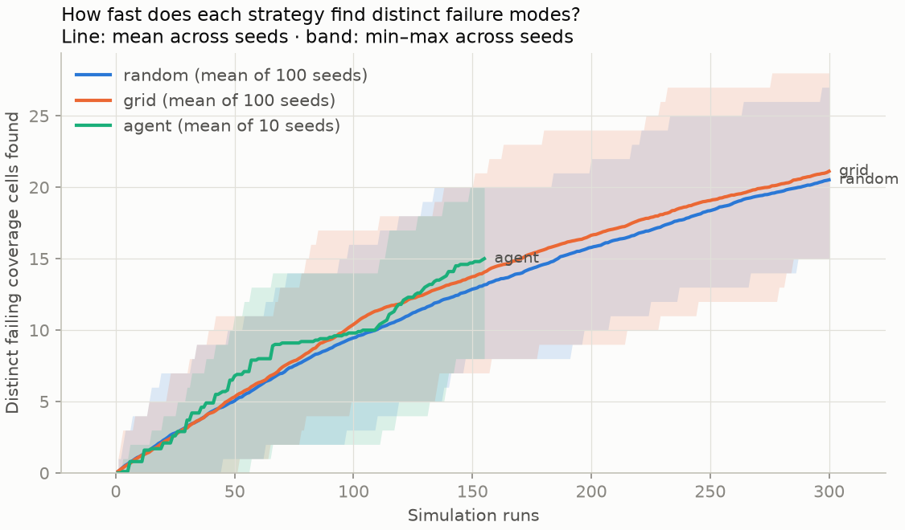

# Search-strategy benchmark

Each strategy is run once per seed with the same budget (the agent may stop early). Detection probability is the share of seeds whose campaign contains at least one run in the region (`avval/benchmark.py::REGIONS`). Runs to first failure is averaged over the seeds that found a failure.

| metric | random | grid | agent |
| --- | --- | --- | --- |
| seeds | 100 | 100 | 10 |
| runs/seed | 300 | 300 | 172 |
| runs to first failure (mean ± SD) | 8.8 ± 8.9 (100/100 seeds found one) | 9.1 ± 8.9 (100/100 seeds found one) | 12.0 ± 16.1 (10/10 seeds found one) |
| distinct failing cells (mean ± SD) | 20.5 ± 2.5 | 21.1 ± 2.8 | 16.1 ± 3.4 |
| P(detect attentive_preventable_collision) [95% CI] | 0.67 [0.57, 0.76] | 0.64 [0.54, 0.73] | 1.00 [0.69, 1.00] |
| P(detect misuse_handback_collision) [95% CI] | 1.00 [0.96, 1.00] | 1.00 [0.96, 1.00] | 1.00 [0.69, 1.00] |
| P(detect silent_margin_erosion) [95% CI] | 0.99 [0.95, 1.00] | 0.99 [0.95, 1.00] | 1.00 [0.69, 1.00] |
| P(detect comfort_exceedance) [95% CI] | 1.00 [0.96, 1.00] | 1.00 [0.96, 1.00] | 1.00 [0.69, 1.00] |

## Matched budget, per seed

Region: `attentive_preventable_collision`. Each agent seed is compared with every baseline campaign cut to the same number of runs the seed used. Baseline probabilities are shares of their campaigns, with 95% Clopper-Pearson intervals.

| seed | runs used | turns | cost | found | random: P(found) at same runs | grid: P(found) at same runs | failing cells | random: cells | grid: cells |
| --- | --- | --- | --- | --- | --- | --- | --- | --- | --- |
| agent_s0 | 177 | 16 | $0.53 | yes | 0.50 [0.40, 0.60] | 0.41 [0.31, 0.51] | 9 | 14.4 | 15.4 |
| agent_s1 | 168 | 19 | $0.63 | yes | 0.47 [0.37, 0.57] | 0.40 [0.30, 0.50] | 16 | 13.9 | 14.8 |
| agent_s2 | 219 | 13 | $0.57 | yes | 0.59 [0.49, 0.69] | 0.47 [0.37, 0.57] | 16 | 16.7 | 17.6 |
| agent_s3 | 168 | 16 | $0.59 | yes | 0.47 [0.37, 0.57] | 0.40 [0.30, 0.50] | 16 | 13.9 | 14.8 |
| agent_s4 | 155 | 24 | $0.66 | yes | 0.44 [0.34, 0.54] | 0.37 [0.28, 0.47] | 19 | 13.2 | 14.1 |
| agent_s5 | 163 | 19 | $0.57 | yes | 0.45 [0.35, 0.55] | 0.39 [0.29, 0.49] | 15 | 13.6 | 14.6 |
| agent_s6 | 162 | 16 | $0.66 | yes | 0.45 [0.35, 0.55] | 0.39 [0.29, 0.49] | 20 | 13.6 | 14.6 |
| agent_s7 | 196 | 19 | $0.58 | yes | 0.51 [0.41, 0.61] | 0.44 [0.34, 0.54] | 15 | 15.6 | 16.4 |
| agent_s8 | 186 | 17 | $0.68 | yes | 0.50 [0.40, 0.60] | 0.42 [0.32, 0.52] | 14 | 15.0 | 15.9 |
| agent_s9 | 178 | 24 | $0.72 | yes | 0.50 [0.40, 0.60] | 0.41 [0.31, 0.51] | 21 | 14.5 | 15.5 |

**Agent:** found the region in 10 of 10 seeds (1.00 [0.69, 1.00]).
Mean distinct failing cells at each seed's own budget: agent 16.1, random 14.4, grid 15.4.

- **random** (100 campaigns) at the same per-seed budgets: 4.88 detections expected out of 10; probability of at least 10: 7.4e-04.
- **grid** (100 campaigns) at the same per-seed budgets: 4.10 detections expected out of 10; probability of at least 10: 1.3e-04.

## Regions

- `attentive_preventable_collision`: `collision AND preventable AND driver_state = 'attentive'`
- `misuse_handback_collision`: `collision AND preventable AND tor_issued AND driver_category = 'foreseeable_misuse'`
- `silent_margin_erosion`: `NOT collision AND NOT tor_issued AND min_ttc_accel < 2.0`
- `comfort_exceedance`: `NOT tor_issued AND max_jerk > 5.0`
