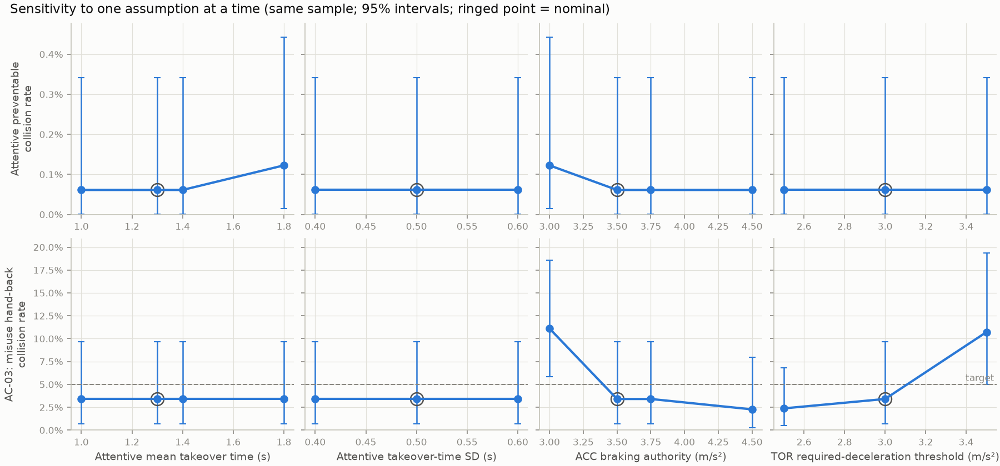

# Sensitivity of the verdict to modelling assumptions

One assumption at a time; every variant re-runs the same exposure-weighted sample (2000 runs, seed 0: identical cases and per-run seeds). Statuses that differ from the baseline are in bold. Each criterion shows status (value, n); the attentive rate has a 95% Clopper-Pearson interval. Full numbers: `sensitivity.csv`.

| assumption | attentive preventable collisions | AC-01 | AC-02 | AC-03 | AC-04 | AC-06 | verdict |
| --- | --- | --- | --- | --- | --- | --- | --- |
| baseline (nominal) | 1/1631 = 0.06% [0.00%, 0.34%] | FAIL (0.000613, n=1631) | PASS (1.88, n=1996) | INSUFFICIENT EVIDENCE (0.0341, n=88) | INSUFFICIENT EVIDENCE (4.99, n=1538) | INFO (0, n=2000) | NO-GO |
| attentive_takeover_mean_s = 1 (nominal 1.3) | 1/1631 = 0.06% [0.00%, 0.34%] | FAIL (0.000613, n=1631) | PASS (1.88, n=1996) | INSUFFICIENT EVIDENCE (0.0341, n=88) | INSUFFICIENT EVIDENCE (4.99, n=1538) | INFO (0, n=2000) | NO-GO |
| attentive_takeover_mean_s = 1.4 (nominal 1.3) | 1/1631 = 0.06% [0.00%, 0.34%] | FAIL (0.000613, n=1631) | PASS (1.87, n=1996) | INSUFFICIENT EVIDENCE (0.0341, n=88) | INSUFFICIENT EVIDENCE (4.99, n=1538) | INFO (0, n=2000) | NO-GO |
| attentive_takeover_mean_s = 1.8 (nominal 1.3) | 2/1631 = 0.12% [0.01%, 0.44%] | FAIL (0.00123, n=1631) | PASS (1.85, n=1995) | INSUFFICIENT EVIDENCE (0.0341, n=88) | INSUFFICIENT EVIDENCE (4.99, n=1538) | INFO (0, n=2000) | NO-GO |
| attentive_takeover_sd_s = 0.4 (nominal 0.5) | 1/1631 = 0.06% [0.00%, 0.34%] | FAIL (0.000613, n=1631) | PASS (1.88, n=1996) | INSUFFICIENT EVIDENCE (0.0341, n=88) | INSUFFICIENT EVIDENCE (4.99, n=1538) | INFO (0, n=2000) | NO-GO |
| attentive_takeover_sd_s = 0.6 (nominal 0.5) | 1/1631 = 0.06% [0.00%, 0.34%] | FAIL (0.000613, n=1631) | PASS (1.87, n=1996) | INSUFFICIENT EVIDENCE (0.0341, n=88) | INSUFFICIENT EVIDENCE (4.99, n=1538) | INFO (0, n=2000) | NO-GO |
| acc_authority_mps2 = 3 (nominal 3.5) | 2/1631 = 0.12% [0.01%, 0.44%] | FAIL (0.00123, n=1631) | PASS (1.6, n=1986) | **FAIL (0.111, n=108)** | **PASS (4.42, n=1445)** | INFO (0, n=2000) | NO-GO |
| acc_authority_mps2 = 3.75 (nominal 3.5) | 1/1631 = 0.06% [0.00%, 0.34%] | FAIL (0.000613, n=1631) | PASS (1.9, n=1996) | INSUFFICIENT EVIDENCE (0.0341, n=88) | **FAIL (5.03, n=1538)** | INFO (0, n=2000) | NO-GO |
| acc_authority_mps2 = 4.5 (nominal 3.5) | 1/1631 = 0.06% [0.00%, 0.34%] | FAIL (0.000613, n=1631) | PASS (1.89, n=1997) | INSUFFICIENT EVIDENCE (0.0227, n=88) | **FAIL (5.03, n=1538)** | INFO (0, n=2000) | NO-GO |
| tor_req_decel_mps2 = 2.5 (nominal 3) | 1/1631 = 0.06% [0.00%, 0.34%] | FAIL (0.000613, n=1631) | PASS (2.02, n=1996) | INSUFFICIENT EVIDENCE (0.0238, n=126) | **FAIL (5.05, n=1340)** | INFO (0, n=2000) | NO-GO |
| tor_req_decel_mps2 = 3.5 (nominal 3) | 1/1631 = 0.06% [0.00%, 0.34%] | FAIL (0.000613, n=1631) | **INSUFFICIENT EVIDENCE (1.58, n=1990)** | **FAIL (0.107, n=84)** | INSUFFICIENT EVIDENCE (4.98, n=1573) | INFO (0, n=2000) | NO-GO |

